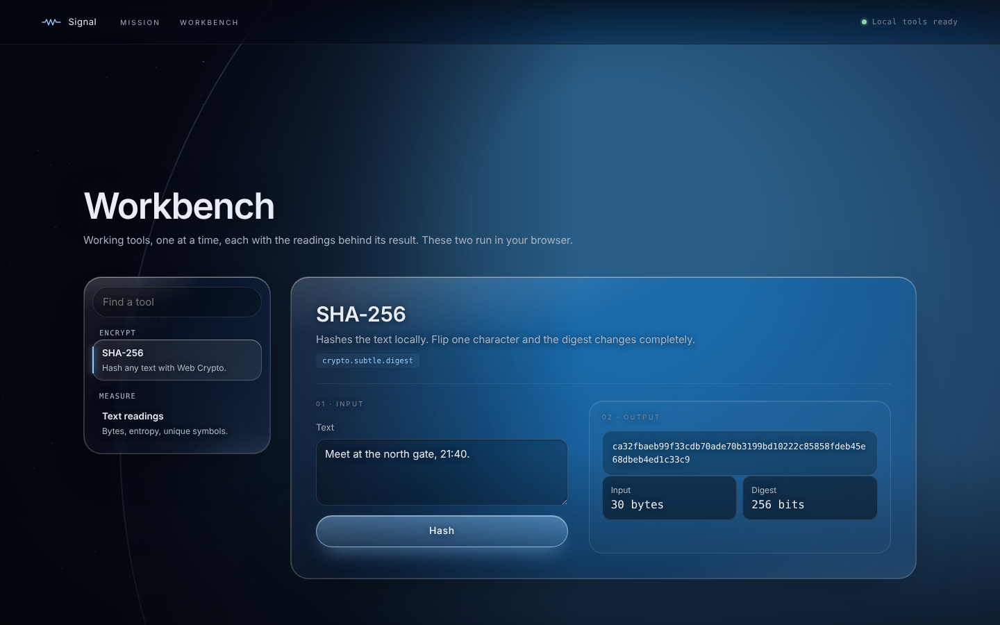

# Liquid Glass Workbench

From the SentinelSpread workbench. 

## Glass rules

- **One place only.** Story copy has no panels; glass is reserved for the workbench so it reads as "this is where you work".
- **Clear, not frosted.** Almost no fill, light blur, bright rim, so the scene stays visible through it:
  ```css
  background: linear-gradient(135deg, rgba(255,255,255,.085) 0%, rgba(255,255,255,.018) 38%, rgba(255,255,255,.03) 70%, rgba(255,255,255,.07) 100%);
  backdrop-filter: blur(6px) saturate(150%) brightness(1.04);
  border: 1px solid rgba(255,255,255,.16);
  border-radius: 26px;
  box-shadow: inset 0 1px 0 rgba(255,255,255,.45),   /* top specular edge */
              inset 1px 0 0 rgba(255,255,255,.16), inset -1px 0 0 rgba(255,255,255,.10), inset 0 -1px 0 rgba(255,255,255,.10),
              inset 0 0 38px rgba(255,255,255,.025),   /* glass thickness */
              0 30px 70px -36px rgba(0,0,0,.55);
  ```
  plus a `::before` with two radial highlights (white top-left, accent bottom-right).
- **Never nested.** Controls inside the glass get tinted fills (`rgba(0,0,0,.22)` inputs, gradient pill buttons with an inset top highlight), never their own blur.
- **Contrast.** Text inside glass uses lighter greys (`#d3dbe8`, captions `#b4bfce`) and a soft `text-shadow: 0 1px 10px` so it stays AA over a bright frame.
- **Fallbacks.** `@supports not (backdrop-filter…)` gets a 90% solid fill. `prefers-reduced-transparency: reduce` gets no blur and a solid `--ink-3`.
- Dim the scene behind the workbench (exposure down, rendering every 4th frame) and let it turn slowly, so the glass has something moving behind it without competing.

## Console layout

- Grid `270–290px | 1fr`. Nav is sticky under the top bar with its own scroll; search pill at the top, sticky group headers (mono, uppercase, with a small icon).
- Nav items: bold name plus a one-line clamped description. Current item gets a white inset ring and a 2px glowing accent bar on the left.
- **One tool on stage.** Hide the rest; animate the new one in (`opacity 0, translateY(8px)`, 0.45s). Search filters items and hides empty groups.
- Tool header: title, one-sentence description, and the endpoint as a small accent code chip (`POST /api/stego/embed`).
- Body: `5fr | 6fr`, columns labelled `01 · Input` and `02 · Output` via `::before`. The output panel is sticky so results stay in view while filling long forms.
- Below 1080px: single column, nav turns into a horizontal scroller, output stops being sticky.

## Results

- Empty state is a dashed placeholder that says exactly what will appear ("The stego image and its distortion readings appear here").
- Results are **readings** (small tiles: label, big mono value) and a **verdict** (dot plus a sentence, green or red). Prefer numbers that prove the result over a success toast.
- Errors: red verdict, with the raw error tucked in a `<details>`.
- Output uses `aria-live="polite"`.
