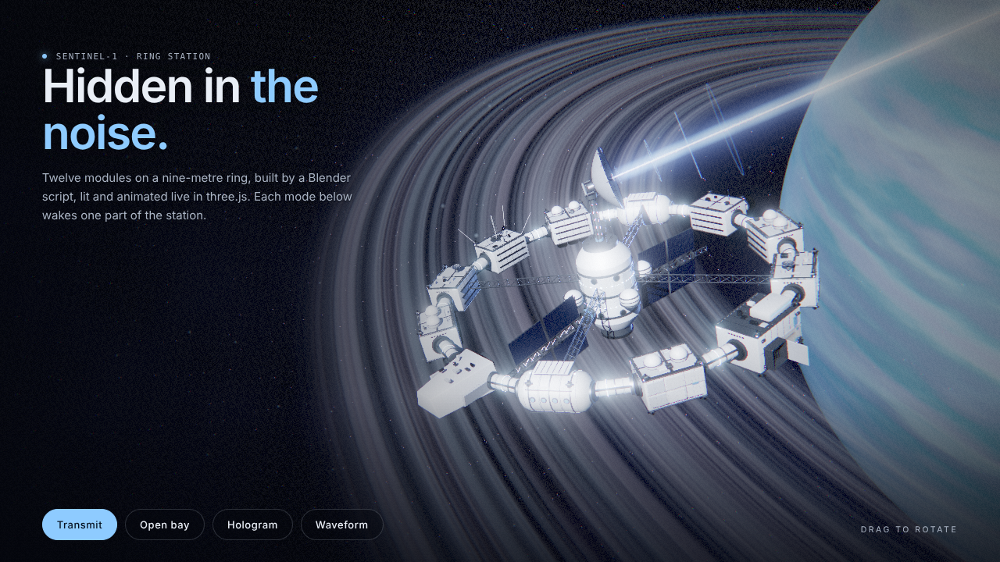

# SENTINEL Ring Station

The signature piece of SentinelSpread. 

Runnable viewer: [demo/index.html](demo/index.html) (serve over http; it loads a GLB). Full source: [references/build_ship.py](references/build_ship.py), [references/ship.js](references/ship.js), [references/textures.js](references/textures.js), [references/preview_ship.py](references/preview_ship.py).

## Why it works

- **The model is code.** One Blender script builds the whole station from primitives, so it's reproducible, diffable and easy to tweak (`blender --background --factory-startup --python build_ship.py -- out.glb`). No hand-modelling, no stock asset.
- **Each part maps to the story.** Each chapter of the page is a part of the station (command module = encryption, dish = transmission, imaging module = image stego, comms helix = audio), and each part has its own live effect.
- **Static geometry is cheap and the effects are live.** The hull bakes into one mesh per material (a handful of draw calls). Everything that moves or glows is added in three.js, so it can respond to scroll and to real events (a live GNU Radio transmission boosts the beam).

## 1. Model it in Blender (build_ship.py)

- **Layout.** 12 modules on a ring of radius 9, one every 30°, joined by corridors. Four spoke trusses (modules 1, 4, 7, 10) to a central hub with a mast and dish, and two solar wings off the hub.
- **Module roles by index.** 0 command (bay door + cipher core), 3 imaging (lens), 6 comms (helix antenna), 9 lander. `i % 3 == 2` engine blocks, 4 and 10 pressure habs, the rest habitats. Variety comes from a few module builders plus seeded greebles, rails, RCS quads and panel seams (`random.Random(1907)`, so every build is identical).
- **Module-local frames.** `module_matrix(i)` puts X on the tangent, Y radially out, Z up, so every module builder works in the same small coordinate system.
- **Materials are a named palette**: Hull, HullPanel, HullWarm, Metal, Dark, Glass, Window (emissive), Radiator, Dish, Accent, Light and NavLight (emissive ×6), Solar. Names matter: the page tunes by material name.
- **One bmesh per material.** Each primitive is built in its own temporary bmesh, transformed, then appended. Never slice indices on a shared bmesh, because bevel frees and reuses vertex slots.
- **Contract with the page.** Moving parts stay separate (`BayDoor` with its hinge at the origin, `Dish` with its mount at the origin). Empties mark attach points: `A_core`, `A_plate`, `A_lens`, `A_comms`, `A_lander`, `A_dish`, plus `F_*` module frames.
- **Collision check.** `SS_ANALYZE=1` builds each part separately and reports triangle overlaps between parts, and between the dish and everything else at 72 aim directions. Use it before choosing where the dish points.
- **Preview without a browser.** `preview_ship.py` renders Workbench stills of the exported GLB.
- Export GLB with Y-up. In three.js, module-local up is +Y and outward is −Z.

## 2. Light it in three.js (ship.js)

- **Environment.** Paint a 512×256 equirect on a canvas (navy gradient, a cold blob toward the gas giant, a hot sun spot), then run it through PMREM and set it as `scene.environment`. Real reflections, no HDR file.
- **Per-material tuning.** `envMapIntensity` Glass 2.4, Metal 1.6, others 1.1; Window emissive 1.2. Everything casts and receives soft shadows except Light and Window.
- **Sun.** One directional key light at 4.6 with a 2048 PCF soft shadow map fitted tightly to the station (±17), bias −0.0004, normal bias 0.04. Add a hemisphere fill and a blue bounce light from the giant.
- **Pose and life.** Tilt the group (0.32, 0.25, −0.1). Add a slow yaw sway (`sin(t*0.05)*0.03`) and a vertical bob (`sin(t*0.3)*0.08`). It should never look parked.
- Fail loudly when a node is missing (`ship model is missing node X`), so a renamed empty is caught on load.

## 3. Live effects on the anchors

All additive-blended, depthWrite off, colors above 1.0 so the bloom pass catches them. Each effect reads one channel, 0 to 1:

| Channel | Part | Effect |
|:--|:--|:--|
| `open` | BayDoor + `A_core` | Door swings `-open*1.9` rad. A spinning wire lattice, a glyph band scrolling round a cylinder, a glow sprite and a point light fade in with `smoothstep(0.25, 0.9, open)`. |
| `beam` (+ `boost`) | `Dish` → HOME | The dish is re-aimed at the distant home planet at load. Then a white-hot core cylinder, a facing-ratio sheath with ripples, 288 points as 16 chips per bit (±1 chips ride either side of the core) streaming home, and 4 expanding wavefront rings. `boost` from a real transmission speeds and widens the rings and fires a flare. |
| `holo` | `F_imaging` / `A_lens` | A floating plane showing the carrier image: a scan head moving down, pixelation near the head, flipped-bit sparkles behind it, 8×8 block grid, scanlines and a bright frame. Four projection rays run from the lens to its corners. |
| `audio` | `A_comms` | 180 instanced bars in a ring around the helix, heights from three sine waves, with tips randomly flashing violet for "LSB changed". |

Expose `anchors` (ship-local points for core, dish, lens, comms, lander) for [pinned-3d-annotations](../../ui/pinned-3d-annotations/SKILL.md), and drive the channels from the chapter ledger in [scroll-chapter-camera](../scroll-chapter-camera/SKILL.md). Each effect is small on the ring, so give it its own camera shot.

## Adapting it

Keep the method and swap the subject: a satellite, a drone, a lab instrument, a building. Write the model as a script with a module-local frame and a material palette, export named anchors, and give each story chapter one part, one effect and one channel.

## Pitfalls

- Don't author emissive or beam colors at 1.0 or below; they won't bloom.
- Aim the dish (or any moving part) only in directions the collision check clears. SentinelSpread's home vector is 76° off the mast axis for that reason.
- Load and `compileAsync` before the first frame, and finish the preloader on that frame.
- The demo needs http, not `file://`, because of the GLB and ES modules.
